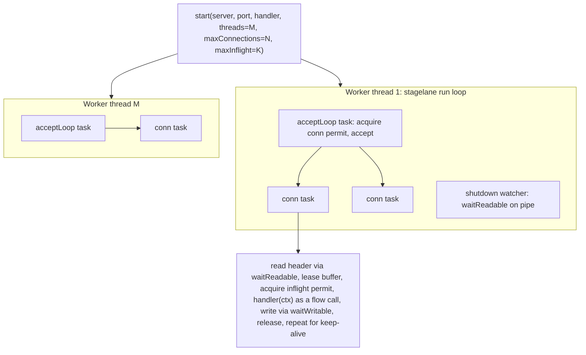

# GuildenStern on stagelane (M:N)

## Is the design viable?

Yes, with three adjustments that come from stagelane's limits.

- **A flow proc cannot be stored in a `proc` variable** (stagelane guide, "Limits"). So `server.requestCallback` cannot hold a `{.flow.}` handler. The handler has to be bound at compile time. `start` becomes a template that generates the worker and connection flow procs around the handler symbol. This is the riskiest part, so step 1 is a spike to test it.
- **Thread-local `socketcontext` and suspension do not mix.** N tasks share one thread and switch at every `waitReadable`/`waitWritable`. That is why handlers will take `ctx: HttpContext` explicitly (you chose this). It also means the request buffer must belong to each request, not each thread. A per-worker buffer pool keeps memory bounded at about `maxInflight * bufferlength` instead of `connections * bufferlength`.
- **There is no fd wait with a timeout.** `sockettimeoutms` is enforced with one wheel timer per connection (`addTimer`) that calls `cancel(connTask)`. The pending `waitReadable` then raises `CancelledError`, and the task closes the socket as `TimedOut`. Each progress event re-arms the timer. Timers are O(1), and no extra task is created per wait.

We do not need stagelane's `Pool` or `-d:flowThreads`. Each worker is a plain Nim thread that calls `run workerMain(...)`, and each thread already gets its own scheduler (a threadvar). Nothing crosses threads except a shutdown pipe, so plain `--mm:orc`/`arc` works. Building with `-d:flowThreads --mm:atomicArc` is still supported for users who want to `pool.go` blocking work out of a handler.

## Architecture



- **Listener:** on Linux, one `SO_REUSEPORT` socket per worker, so the kernel balances connections. Elsewhere (macOS), one shared non-blocking listener fd that every worker's selector watches. Losers of the accept race get `EAGAIN` and park again. A worker at its limit stops accepting, so the other workers pick up the load.
- **Limits (per worker, `ceil(N/M)` and `ceil(K/M)`):**
  - Connection `Semaphore`: the accept loop calls `acquire` before `accept`. When the worker is full, it stops accepting and the kernel backlog absorbs the load.
  - In-flight `Semaphore`: acquired after the header is read and held until the response finishes. Idle keep-alive connections do not count against it.
- **Connection task:** it never raises. It catches everything, so the `scope` fail-fast cannot cancel sibling connections. It reads optimistically (`recv` first, `waitReadable` only on `EAGAIN`), which avoids epoll register/unregister syscalls on the hot path. Bytes left over after a request are kept for the next one, which fixes how pipelined requests are handled today.
- **Shutdown:** `shutdown()` writes to each worker's self-pipe (async-signal-safe, so it also works from `onSignal`). The watcher task cancels the accept loop, waits up to a grace period for the connection scope to drain, cancels whatever is left, and then the thread returns from `run`.

## API sketch

```nim
proc handle(ctx: HttpContext) {.flow.} =
  if ctx.isUri("/slow"): delay(200)
  ctx.reply("hello " & ctx.getUri())

let server = newHttpServer(loglevel = lvlInfo, contenttype = Compact)
server.start(8090, handle, threads = 4, maxConnections = 1000, maxInflight = 64)
server.join()
```

- Request accessors (`getUri`, `isUri`, `getMethod`, `getBody`, `headers`, and the rest) become plain procs on `ctx`. They stay pure, so they compile to native code.
- Everything that does I/O becomes `{.flow.}`: `reply*`, `replyStart`/`replyMore`/`replyFinish`, the chunked variants, and a new `readBodyChunk(ctx): string` that replaces the `receiveStream` iterator (an iterator body that pauses only runs over a snapshot). Drop `raises: []` on flow procs, because they can raise `CancelledError`.
- `replyPending`, `withPending`, and `PendingReply` go away. A handler just suspends.

## Files

- [guildenstern/guildenserver.nim](guildenstern/guildenserver.nim): reduce to config, logging, `shuttingdown`/`shutdown()`, and `SocketCloseCause`. Remove the pending-slot machinery, the `socketcontext` threadvar, `suspend`, flags, the deferred callbacks, and `registerSocket`.
- New `guildenstern/stagedispatcher.nim`: workers, listener(s), `acceptLoop`, the limits, the timeout timer, the buffer pool, shutdown pipes, and the `start` template.
- [guildenstern/httpserver.nim](guildenstern/httpserver.nim), [guildenstern/httprequest.nim](guildenstern/httprequest.nim), [guildenstern/httpresponse.nim](guildenstern/httpresponse.nim): switch to `ctx` parameters and turn `receiveHeader`, `receiveToSingleBuffer`, and `writeToSocket` into flow procs. Replace the backoff/`suspend` loops with `waitReadable`/`waitWritable`. Assemble the status line and headers into one buffer, so a reply is one or two sends.
- Delete `dispatcher.nim`, `epolldispatcher.nim`, `epoll.nim`, and `guildenselectors.nim`. Update [guildenstern.nim](guildenstern.nim).
- [guildenstern.nimble](guildenstern.nimble): `requires "nim >= 2.2.0"` and `requires "https://github.com/ghazalialshafi/stagelane"`. For local development, use a `--path:/Users/alexboisvert/nim/stagelane/src` override in [config.nims](config.nims).
- Examples: port `helloworld`, `httptest`, and `getandpost`. Replace `asyncpending.nim` with `asynchandler.nim`, which uses `delay` and small limits so back-pressure is visible.

## Risks to check early (spike)

1. Can a `{.flow.}` proc be generated inside a template (gensym, or injected) and call a handler symbol that is passed in?
2. Can several threads' selectors watch the same listener fd? Specifically, check stagelane's per-scheduler "another task already waits on this fd" check, and kqueue on macOS.
3. Do `{.gcsafe.}` and `{.cast(gcsafe).}` work with flow procs called from a thread proc?
4. If (1) fails, the fallback is a top-level `httpServer(name, handler)` macro that the user invokes once per server.

## Verification

- Compile each example with `--mm:orc` and with `-d:flowThreads --mm:atomicArc`.
- Load: `hey -n 20000 -c 200` ([load-test.sh](load-test.sh)) against helloworld.
- Back-pressure: run `asynchandler` with `maxInflight=2` and a 200 ms handler, and check that concurrency peaks at 2 and the timestamps overlap.
- Timeout: an idle `nc` connection should close after `sockettimeoutms`.
- Shutdown: send SIGINT while requests are in flight. Requests should finish within the grace period, and all threads should join.