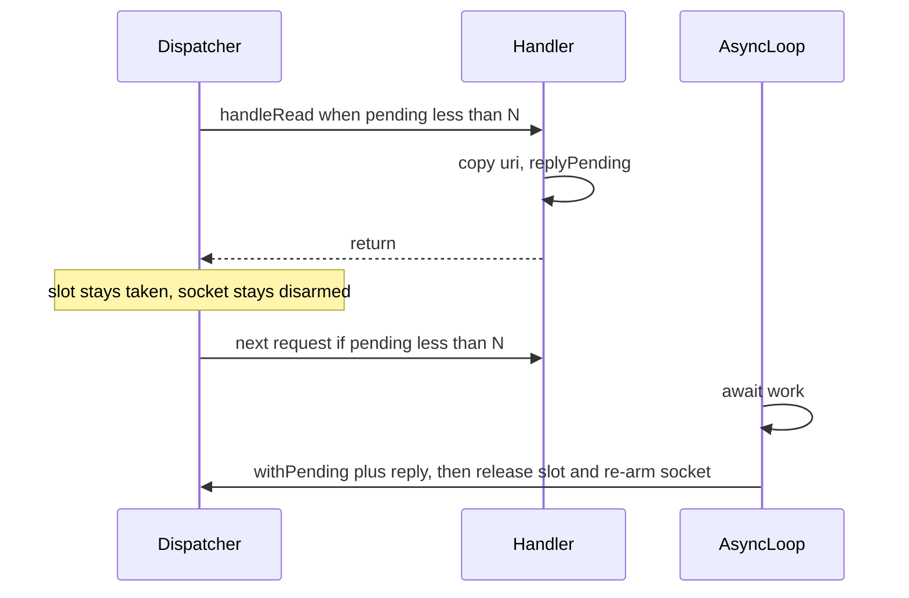

# Concurrent pending HTTP replies

## Behavior

Today a worker calls [`handleRead`](stagecoach/coachserver.nim), the handler must `reply()` before returning, and only then does the dispatcher re-arm that socket. [`socketcontext`](stagecoach/coachserver.nim) is a threadvar, so the next request on that worker reuses the same buffer.

New flow:

- `newHttpServer(..., maxPendingRequests = N)` stores N on the server. `0` (the default) keeps today's synchronous behavior, and `replyPending()` is only valid when N is greater than 0.
- Each dispatcher reserves one slot immediately before `handleRead` and blocks while `pendingCount >= N`. The slot is released when the handler returns without `replyPending()`, or later when the deferred reply finishes.
- The same connection is not read again until that deferred reply is written. Other connections still proceed, up to N.

## API

In [`stagecoach/httpresponse.nim`](stagecoach/httpresponse.nim) (included by the http server):

- `replyPending(): PendingReply` captures the current socket and server and sets a threadvar so the dispatcher keeps the slot. The handler must copy anything it still needs (`getUri()` / `getBody()` already return copies) and then return without calling `reply()`.
- `withPending(pending, body)` installs that socket as the current `socketcontext` on whatever thread runs it, runs `body` so the existing `reply()` variants work unchanged, then always re-arms the socket and releases the slot.

`PendingReply` is a shared ref so the async thread can complete it. A second completion is ignored. Closing the socket while it is still pending also releases the slot, so a dropped client cannot leave the dispatcher blocked at N.

## Dispatcher gate

Add `maxPendingRequests`, a lock, a condition variable, and `pendingCount` to [`StagecoachServerObj`](stagecoach/coachserver.nim), plus `acquirePendingSlot` / `releasePendingSlot` and a `requestDeferred` threadvar cleared at the start of `handleRead`. `suspend` will adjust the active-thread count only on dispatcher worker threads, because a deferred `reply()` can run elsewhere and may call `suspend` if a write blocks.

Both dispatchers enforce the cap, since either one can run an `HttpServer`:

- [`stagecoach/dispatcher.nim`](stagecoach/dispatcher.nim): around `handleRead` in `workerthreadLoop`. If the handler deferred, skip `restoreRead`. Completion calls a small server callback that does the same re-arm (`isprocessing = false`, read interest restored).
- [`stagecoach/epolldispatcher.nim`](stagecoach/epolldispatcher.nim): same reserve/release around each `handleRead`. If the handler deferred, leave `processing` set and leave the read loop so that socket is not drained again. Completion clears `processing`.

`acquirePendingSlot` also wakes on shutdown so a blocked worker cannot stick during `shutdown()`.

## Example

Add [`examples/asyncpending.nim`](examples/asyncpending.nim) and a nimble task, using the default dispatcher (this machine is macOS; epoll is the Linux dispatcher).

- `newHttpServer(onRequest, maxPendingRequests = 2)`, started with a small thread pool.
- A dedicated thread runs `asyncdispatch`. The http callback copies the URI, calls `replyPending()`, and sends the token across a `Channel`. It does not `asyncCheck` on the worker thread, because that thread never polls.
- The async loop `await sleepAsync(...)` per job, then `withPending` + `reply`. Two jobs overlap; a third handler call waits until one of them finishes. Logs include timestamps so that overlap is visible.
- The process stays up until shutdown, matching [`examples/helloworld.nim`](examples/helloworld.nim).

## Check

Compile the new example and a synchronous one (`helloworld` or `httptest`) so the default `maxPendingRequests = 0` path still builds. No browser pass; this is a socket server.