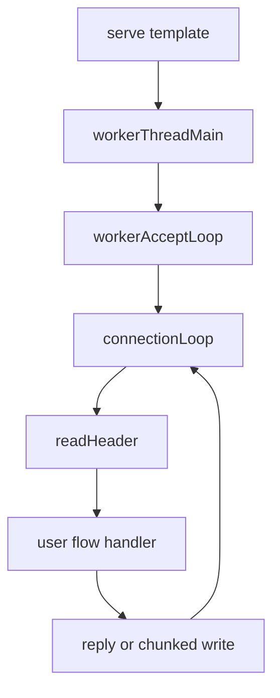

# Stagecoach design review

First-party code is about 1,100 lines under [stagecoach/](stagecoach/). `deps/stagelane` is the vendored runtime and is out of scope. This repo is not in the code graph, so this is from a full read of the stagecoach sources and the stagelane accept/timer APIs they call.

## Architecture

One process can host several `HttpServer`s. Each `serve` starts N OS threads (default: CPU count). Each thread runs its own stagelane loop.



- Linux: one `SO_REUSEPORT` listener per worker ([stagecoach/stagedispatcher.nim](stagecoach/stagedispatcher.nim) `makeListener`). Other OS: one shared nonblocking listener; `accept` is safe to call from each loop.
- Each worker has two semaphores: connections (`connLimit`, default 1024) and handlers in flight (`inflightLimit`, default 64), both split with `ceil(limit / nThreads)` and a floor of 1.
- A connection task reads one request into a fixed buffer, runs the handler, writes the response, and peeks the socket for keep-alive.
- [stagecoach/httpserver.nim](stagecoach/httpserver.nim) is the only real compilation unit. [httprequest.nim](stagecoach/httprequest.nim), [httpresponse.nim](stagecoach/httpresponse.nim), and [stagedispatcher.nim](stagecoach/stagedispatcher.nim) are `include`d into it. [flow.nim](stagecoach/flow.nim) re-exports the stagelane transform so user handlers can be `{.flow.}`. [coachserver.nim](stagecoach/coachserver.nim) owns logging, the process-wide `shuttingdown` flag, and `closeSocket`.
- `serve` stays a template on purpose. stagelane rewrites `{.flow.}` at compile time, and the user handler has to be visible at the `handler(ctx)` call inside `connectionLoop`. Turning that into a proc-typed callback would fight the transform.

## Problem areas

### Bugs

- **EOF is treated as “try again”, then spun on.** [classifyRecv](stagecoach/httprequest.nim) returns `TryAgain` when `recv` returns 0. [recvSome](stagecoach/httprequest.nim) returns 0 immediately. [receiveHeader](stagecoach/httprequest.nim) and [receiveToSingleBuffer](stagecoach/httprequest.nim) `continue` on `TryAgain`, so a peer close becomes a busy loop. `EAGAIN` is already absorbed inside `recvSome`, so this `TryAgain` path is almost only the EOF mistake.
- **Double close.** [closeSocket](stagecoach/coachserver.nim) calls `posix.close` and leaves the fd unchanged. [connectionLoop](stagecoach/stagedispatcher.nim) closes `ctx.socket` again in `finally` whenever it is not `INVALID_SOCKET`. With several accept threads, the kernel can reuse that number before the second close. The second close then hits another connection.
- **Header plus body can run past the buffer.** The context buffer is `bufferlength + 1` (100001). Compact mode rejects only when `contentlength > bufferlength`. The body is written at `bodystart`, so a 10KB header and a 100000-byte body write off the end of the string in [receiveToSingleBuffer](stagecoach/httprequest.nim).
- **Bytes already read are thrown away on the next keep-alive request.** One `recv` often contains the rest of request N and the start of request N+1. [prepareHttpContext](stagecoach/httprequest.nim) sets `requestlen = 0` and the extra bytes are never replayed. Pipelined or coalesced keep-alive requests desync.
- **Streaming drops the body prefix that arrived with the headers.** [readBodyChunk](stagecoach/httprequest.nim) only returns the buffered prefix when the whole body is already present. Otherwise it reads the next chunk at index 0 (overwriting the request line) and returns only that new slice.
- **`isBody` indexes the comparison string with the buffer offset.** The loop uses `body[i]` while `i` starts at `bodystart`, so it compares the wrong bytes and can read off the end of `body`.
- **Content-Length search is wrong on the default path** (no `headerfields`, which is the default). The Boyer–Moore window uses `maxShift = last - patternLen`, so the last legal alignment is skipped. Case folding only special-cases `c` and `l`, so `CONTENT-LENGTH` does not match. `array[high(char), int]` is 255 slots, not 256. A straight case-insensitive scan of a header that is at most 10KB is cheaper than a syscall and removes this table.
- **Close reasons use Linux errno numbers** (`104` for reset). On macOS `ECONNRESET` is 54, so a reset is logged as a generic network error. `MSG_MORE` is hard-coded to `0x8000`, which is Linux-only; chunked writes on macOS can fail with `EINVAL`. Normal replies do not use that flag.
- **Idle timeout is stored and never armed.** `sockettimeoutms = 5000` has no reader. stagelane already has `addTimer` and `cancel`. A client that connects and sends nothing holds a connection slot until process shutdown.
- **Shutdown does not wake `accept`.** The pipe is only `read` at the top of the loop. `listener.accept` then blocks in `waitReadable` on the listener alone. `SIGINT` sets `shuttingdown` and writes the pipe, but a worker blocked in accept stays there until another connection arrives.
- **The server object is invisible to the GC.** `newHttpServer` uses `allocShared0` and stores a raw `ptr`. `HttpRuntime` holds that pointer, and the GC does not follow it. `name`, `headerfields`, and the log callback live inside that blob. That is the old shared-memory dispatcher pattern; it is the wrong ownership model for ORC.

### Structure, duplication, performance, maintenance

- Request, response, and the dispatcher share one include scope, so none of them can be compiled or tested alone. Helpers such as `classifyRecv` and `classifySend` repeat the same errno branch.
- [stagecoach/sha.nim](stagecoach/sha.nim) is a copy of the Nim stdlib SHA-1 module. Nothing in the HTTP path calls it. [stagecoach.nim](stagecoach.nim) imports it only so `nimble build` type-checks it. It is leftover from the removed WebSocket handshake.
- [coachserver.nim](stagecoach/coachserver.nim) `log` takes `message: string`, so the string is built before the level check. [parseRequestLine](stagecoach/httprequest.nim) therefore allocates a debug line on every request even at `lvlWarn`.
- Every connection zeroes a 100KB string and, in the default Compact mode, a header table that the default read path never uses (`headerfields.len == 0` skips `parseHeaders`).
- `ceil` plus `max(1, …)` means a limit of 1 with 8 threads allows 8 connections. The README describes the split; the floor should be documented as a real cap leak, not treated as a global limit.
- `keepAlive` is never cleared. `Connection: close` is ignored. Request chunked bodies are ignored. HTTP/1.1 is checked by two bytes (`H` and the minor digit), so `HXXXXXX1` passes.
- Version is `9.0.3` in code and `0.1` in [stagecoach.nimble](stagecoach.nimble). There is no test module. [examples/asynchandler.nim](examples/asynchandler.nim) increments a process-global `inflight` from worker threads with no synchronization.
- `httpRuntimes` and `nextid` only grow. Shutdown never joins, closes listeners, or closes pipes. `wait` only joins threads.

## Refactoring strategy

Fix the connection lifecycle in place. Do not add a second parser, a buffer pool, or a callback-based `serve`.

1. Make `HttpServer` a `ref object` so the GC retains its strings and seqs. Keep the public fields.
2. One close path. `closeSocket` sets `ctx.socket = INVALID_SOCKET` before `posix.close`. The `finally` in `connectionLoop` closes only if the handler did not.
3. Treat `recv == 0` as peer close. Map errno with `ECONNRESET`, `EPIPE`, `EBADF`, `EFAULT`, not decimal literals. Use `MSG_MORE` only when `defined(linux)`.
4. Reject a Compact body when `bodystart + contentlength` exceeds the buffer. Replace the Boyer–Moore table with a case-insensitive header scan. Fix `isBody` to compare `body[i - bodystart]`.
5. Keep a carry count of bytes already read past the current body, and move them to the front in `prepareHttpContext`. On the streaming path, return that prefix before reading more, into a region that does not overlap the request line.
6. Arm `sockettimeoutms` with `addTimer` on each wait, cancel the connection task on expiry, and cancel that timer on progress. For shutdown, `go` a task that `waitReadable`s the pipe and `cancel`s the accept task so `accept` is not stuck in `waitReadable`.
7. Change `log`’s message parameter to `untyped` so debug text is built only when the level is enabled.
8. Turn the three includes into real modules only where they do not need the `serve` template’s captured handler. Leave `serve` / `connectionLoop` as the template. Stop compiling [sha.nim](stagecoach/sha.nim).
9. Add a parser test with no sockets (method, URI, `isBody`, content-length case, buffer bound) and one socket test for peer close, keep-alive coalescing, and idle timeout.

Leave these for a later pass: connection-slot pooling, a true global connection cap, `Connection: close`, request chunked encoding, and writev replies. Those are real, and they are not why a keep-alive client can desync or a closed fd can be closed twice.

## Improved code

Target shape of the receive and close path:

```nim
proc classifyRecv(ret: int, server: StagecoachServer, ctx: HttpContext): SocketState =
  if shuttingdown: return Fail
  if ret > 0: return Progress
  if ret == 0:
    closeSocket(ctx, ClosedbyClient, "peer closed")
    return Fail
  let e = osLastError()
  if e in {EAGAIN, EWOULDBLOCK}: return TryAgain
  let cause = case e
    of EBADF: AlreadyClosed
    of EFAULT: EFault
    of EPIPE: ConnectionLost
    of ECONNRESET: ClosedbyClient
    else: NetErrored
  closeSocket(ctx, cause, osErrorMsg(e))
  Fail

proc closeSocket(ctx: HttpContext, cause = CloseCalled, msg = "") =
  let fd = ctx.socket
  if fd == INVALID_SOCKET: return
  ctx.socket = INVALID_SOCKET
  closeSocket(ctx.server, fd, cause, msg)
```

Carry-over at the start of the next request, instead of discarding `requestlen`:

```nim
proc prepareHttpContext(ctx: HttpContext, server: HttpServer) =
  if ctx.pending > 0:
    moveMem(addr ctx.request[0], addr ctx.request[ctx.pendingStart], ctx.pending)
  ctx.requestlen = ctx.pending
  ctx.pending = 0
  # reset uri, method, body, content-length; do not wipe the carried bytes
```

Idle timeout, using the timer wheel already in stagelane, cancelled on each successful read or write and on task exit. Shutdown watcher: a sibling flow task on the pipe fd that `cancel`s the accept task so the listener wait unblocks.
