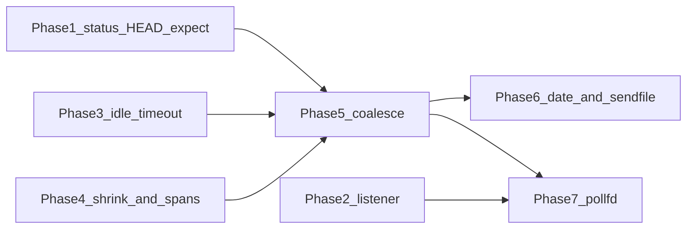

# Stagecoach request-path improvements

Work only in `/Users/alexboisvert/git/GuildenStern` (stagecoach `6fa77ce` and newer). Do not edit `/Users/alexboisvert/nim/stagehttp`. Do not commit unless the parent agent asks. After each phase the tree must compile, the comments that phase lists must be in the code, and `just test-one <suite>` for the suites that phase names must pass. The last phase runs `just test`. A step inside a phase is not done while the decision it just introduced is still uncommented.

Source of the behavior list: [specs/stagehttp-vs-stagecoach.md](/Users/alexboisvert/nim/stagehttp/specs/stagehttp-vs-stagecoach.md) section “What stagecoach should take”. Reference implementations to read, not to copy wholesale:

- Session, parse, lease, send: [guildenstern/stagehttp.nim](/Users/alexboisvert/nim/stagehttp/guildenstern/stagehttp.nim)
- `PollFd`: [stagelane/src/stagelane/sched.nim](/Users/alexboisvert/nim/stagehttp/stagelane/src/stagelane/sched.nim) from the `when defined(linux)` block “persistent, edge-triggered descriptors” through `pioDispatch`, plus `pollIo`, `ParkKind.pkPio`, and the `pkPio` arm in `cancelLocal`

## Locked design

- `reply` stays the handler API and stays `{.flow.}`. Outside the session loop it still writes immediately, so [tests/t_response.nim](/Users/alexboisvert/git/GuildenStern/tests/t_response.nim) wire strings stay the same while `sendDate` is off.
- Inside `connectionLoop`, `ctx.holdWrites = true`. `reply` only appends a full message to `ctx.sendBuf`. The session flushes before any park (`recvSome` / `sendSome` / `waitSocket*`) and again in the connection `finally`. Chunked procs and `reject` flush immediately. Never park with a non-empty `sendBuf`.
- Idle timeout is not a reaper. stagecoach has no per-worker connection list, and every wait already arms one timer. A first-byte wait uses `idleTimeoutms` and `shutdown`s the socket; an in-progress read/write keeps `sockettimeoutms` and still cancels the task.
- Header values become offsets into `ctx.request`. `headerValue` slices on demand. Internal framing (Content-Length, Connection, Transfer-Encoding, Expect) parses those bytes in place.
- `PollFd` is Linux-only and only for accepted connection sockets. `accept`, the shutdown pipe, and non-Linux builds keep `waitReadable` / `waitWritable`.

Phases 1, 2, 3, and 4 touch different concerns. 1 and 4 both edit `httprequest.nim`, so run 4 after 1. 3 and 5 both edit `socketio.nim`, so run 5 after 3. 2 is independent and can run beside 1.

## Comments

Comment the reason a reader would get wrong, in the voice already used in stagecoach: `##` on a proc, `#` on a branch. Say why a branch exists, how long a pointer stays valid, or which invariant the next lines keep. Do not restate the code, and do not add a banner that repeats this plan. Each phase below names the comments it must leave. Write the comment in the same step that writes the code it explains.

## Phase 1 — Status, then close; HEAD; Expect

**Why.** A client that sent a bad request, a body the server will not read, or a handler that crashed currently sees the TCP connection disappear. Logs on the server name the close cause; the client cannot tell 400 from 413 from a crash, and it may retry the same request. Writing the status and then closing makes the failure actionable, keeps the existing close-cause log for operators, and matches what caches, browsers, and load generators already branch on.

`HEAD` is the same handler as `GET` with an empty body. Without suppression, a shared handler sends the representation twice: once as `Content-Length` and again as bytes the method forbids. Clients and conditional-GET caches then disagree about the resource. Skipping the body while keeping the length makes one handler correct for both methods.

`Expect: 100-continue` exists so a client can wait before uploading a large body. Streaming and Compact are exactly that case. A server that ignores `Expect` leaves the client blocked until its own timeout; a server that accepts some other expectation and then reads a body the client will not send stalls the connection. `100 Continue` unblocks a real upload; `417` rejects anything else immediately.

A handler that returns without `reply`, or raises before it writes, is the same hole: the client waits until `sockettimeoutms` or idle close. A `500` ends that wait and tells the client the request will not succeed if retried unchanged. A handler that already wrote a status must not get a second status line, or the stream is no longer HTTP.

**Files:** [stagecoach/httprequest.nim](/Users/alexboisvert/git/GuildenStern/stagecoach/httprequest.nim), [stagecoach/httpresponse.nim](/Users/alexboisvert/git/GuildenStern/stagecoach/httpresponse.nim), [stagecoach/httpservercore.nim](/Users/alexboisvert/git/GuildenStern/stagecoach/httpservercore.nim), [stagecoach/socketio.nim](/Users/alexboisvert/git/GuildenStern/stagecoach/socketio.nim), [tests/t_io.nim](/Users/alexboisvert/git/GuildenStern/tests/t_io.nim), [tests/t_parser.nim](/Users/alexboisvert/git/GuildenStern/tests/t_parser.nim), [tests/t_response.nim](/Users/alexboisvert/git/GuildenStern/tests/t_response.nim).

**New `HttpContext` fields** (reset in `prepareHttpContext`):

- `responded: bool` — a status line was appended or flushed
- `headOnly: bool` — method is exactly `HEAD`
- `holdWrites: bool` — leave false in this phase

**`reject(ctx, code: HttpCode, cause: SocketCloseCause, msg: string)`** in `httpresponse.nim`:

- If `ctx.socket == INVALID_SOCKET` or `ctx.responded`, only `closeHttpSocket` when the socket is still open (do not write a second status).
- Otherwise build one short message: `HTTP/1.1 ` + `$code` + `\r\nConnection: close\r\nContent-Length: N\r\n\r\n` + a one-line reason. No body for `headOnly`. Set `responded`, `keepAlive = false`, write it with the existing `sendSome` / `lastSendFlags`, then `closeHttpSocket(ctx, cause, msg)`.
- Map: header larger than `maxheaderlength` → `Http431`; Compact `Content-Length` past `bufferlength` → `Http413`; any non-empty `Transfer-Encoding` → `Http501`; `Expect` other than `100-continue` → `Http417`; every other current `ProtocolViolated` close in `httprequest.nim` → `Http400`. Keep the existing close-cause enum value (`ProtocolViolated` for all of these) so [tests/t_io.nim](/Users/alexboisvert/git/GuildenStern/tests/t_io.nim) cause checks still pass.
- Server-stopping / shutting-down paths stay silent closes. No status.

**Call sites:** every `closeHttpSocket(ProtocolViolated, ...)` and the header-size / body-size closes in `parseMethod`, `parseRequestLine`, `parseHeaders`, `processHeaders`, `receiveHeader`. `readBodyChunk` timeout stays `TimedOut` with no status if bytes of a response were already sent; if the failure is still inside `beginRequest` before the handler, use `reject`.

**HEAD:** in `parseRequestLine`, after the method token is accepted, `headOnly = methlen == 4 and bytesEq(request, 0, "HEAD")`. In `reply` (all three overloads) and chunked builders, still write `Content-Length` of the representation and skip the body bytes when `headOnly`. Chunked `HEAD` writes the headers and no chunks.

**Expect:** in `newHttpContext`, always add `"expect"` to `wanted` the way `"content-length"` is added. In `processHeaders`, if the value is non-empty and is not the token `100-continue` (case-insensitive, comma-separated, same rules as `hasConnToken`), `reject` 417. If it is `100-continue` and the body is not already fully in the buffer (`contentreceived < contentlength` and `contentlength > 0`), append `HTTP/1.1 100 Continue\r\n\r\n` and flush it before `receiveToSingleBuffer` or the first `readBodyChunk`. Do not send `100` when the body already arrived with the headers.

**Handler failures** in `connectionLoop` ([stagecoach/stagedispatcher.nim](/Users/alexboisvert/git/GuildenStern/stagecoach/stagedispatcher.nim)):

- `CancelledError`: close `Cancelled`, no status.
- Other `CatchableError`: if not `responded`, `reject(Http500, Excepted, ex.msg)`; if `responded`, flush `sendBuf` if this phase already has a flush helper, else the existing write already happened, then `closeHttpSocket(Excepted, ex.msg)`.
- After a normal handler return, if not `responded`, `reject(Http500, Excepted, "handler sent no reply")` and stop the connection.

**Tests:** extend `t_io` so the peer reads a status line: 431 oversized header, 400 bad request line, 501 `Transfer-Encoding: chunked`, 417 `Expect: foo`, and a `100` then the real reply for `Expect: 100-continue` with a body that arrives after the `100`. Add a `t_response` case: `HEAD` + `reply("abc")` is `Content-Length: 3` and no `abc`. `just test-one io`, `just test-one parser`, `just test-one response`.

**Comments this phase must leave:**

- On `reject`: a second status is skipped once `responded` is set, because another status line would no longer be HTTP. Stopping and shutting down stay silent closes.
- On `headOnly`: `Content-Length` is the size of the representation; the body bytes are omitted.
- On the `Expect` branch: `100-continue` is flushed before the body is read, and only when the body is not already buffered. Any other expectation is 417.
- In `connectionLoop`: a handler that wrote nothing becomes 500; a handler that already wrote a status is closed without a second status.

## Phase 2 — Listener backlog, defer-accept, close-on-exec

**Why.** The accept loop stops calling `accept` once the connection semaphore is exhausted, and the kernel backlog is what absorbs the burst until a permit frees. A backlog of 128 fills while the worker is still under its connection cap, so clients get `ECONNREFUSED` even though the server had room. A default of 4096 makes the semaphore the back-pressure, which is the limit the operator configured. Exposing `backlog` lets a small deployment shrink it.

`TCP_DEFER_ACCEPT` holds `accept` until the first request bytes are queued. The connection task then reads data that is already there instead of parking, timing out, and waking for an empty socket. That cuts a wakeup on every new connection that actually sends a request, and it drops clients that connect and never write before they occupy a task. It is Linux-only; a failed setsockopt must not stop the listener on a kernel that lacks it.

Close-on-exec keeps listener and connection fds out of any process a handler later spawns. Without it, a child inherits the listen socket and can accept connections the parent still owns, or keep the port open after the parent exits. Setting the flag at accept time fixes that without a stagelane change.

**Files:** [stagecoach/httpservercore.nim](/Users/alexboisvert/git/GuildenStern/stagecoach/httpservercore.nim), [stagecoach/stagedispatcher.nim](/Users/alexboisvert/git/GuildenStern/stagecoach/stagedispatcher.nim), [stagecoach/socketio.nim](/Users/alexboisvert/git/GuildenStern/stagecoach/socketio.nim), [tests/t_core.nim](/Users/alexboisvert/git/GuildenStern/tests/t_core.nim), [README.md](/Users/alexboisvert/git/GuildenStern/README.md).

**Fields on `HttpServer`:** `backlog*: int` default `4096` in `initHttpServer`. `0` means 4096, same pattern as the other knobs if any caller passes 0; otherwise document that the default is 4096 and `setupRuntime` uses `srv.backlog`.

**`makeListener`:** replace hardcoded `posix.listen(fd, 128)` and the non-Linux `listenTcp(port)` (backlog 128 in [deps/stagelane/src/stagelane/net.nim](/Users/alexboisvert/git/GuildenStern/deps/stagelane/src/stagelane/net.nim)) with `srv.backlog`. Non-Linux can keep `listenTcp(port, "0.0.0.0", backlog)` — that parameter already exists.

**Linux only**, after `SO_REUSEPORT`: `setsockopt(fd, IPPROTO_TCP, 9, 1)` (`TCP_DEFER_ACCEPT`). Ignore a failed setsockopt; do not fail the bind.

**Close-on-exec:** `fcntl(fd, F_SETFD, FD_CLOEXEC)` on the listener in `makeListener`, and on the accepted fd at the start of `connectionLoop` before `setNoDelay`. Do not change `sockAccept` in stagelane in this phase.

**Tests:** `t_core` asserts `backlog == 4096`. No new network assertion for defer-accept. `just test-one core`.

**Comments this phase must leave:**

- On `backlog`: the listen queue absorbs the burst until the connection semaphore is the cap. 128 filled while the worker still had permits.
- On `TCP_DEFER_ACCEPT`: `accept` returns with the first request bytes already queued. A failed setsockopt does not fail the bind.
- On both `FD_CLOEXEC` sites: a child must not inherit the listen socket or a connection.

## Phase 3 — Idle timeout is not the socket timeout

**Why.** `sockettimeoutms` defaults to 5 seconds and wraps every `waitReadable`, including the wait for the next request after a successful reply. A keep-alive client that thinks for more than 5 seconds is cancelled, the task dies as `Cancelled`, and the log does not say the connection was idle. Keep-alive is then useless for anything slower than that cap, and operators cannot tell an idle close from a stuck handler.

Splitting the clocks gives each one a job. Idle (default 30 seconds) closes a connection that has not started a request, and the close cause is `TimedOut` so the log is honest. `sockettimeoutms` still bounds one read or write that is part of a request already in progress. `requestTimeoutms` still bounds a header or body that arrives a byte at a time, which is the slowloris control. A quiet pool of keep-alive clients survives; a stalled upload does not.

Shutdown rather than task-cancel is deliberate. Cancelling the task aborts a handler that might still be finishing, and it is the wrong signal for “nobody is speaking.” Shutting the socket down wakes the read, the session closes itself, and an in-progress handler is left alone until its own socket timer.

**Files:** [stagecoach/httpservercore.nim](/Users/alexboisvert/git/GuildenStern/stagecoach/httpservercore.nim), [stagecoach/socketio.nim](/Users/alexboisvert/git/GuildenStern/stagecoach/socketio.nim), [tests/t_io.nim](/Users/alexboisvert/git/GuildenStern/tests/t_io.nim), [tests/t_core.nim](/Users/alexboisvert/git/GuildenStern/tests/t_core.nim), [README.md](/Users/alexboisvert/git/GuildenStern/README.md).

**Field:** `idleTimeoutms*: int` default `30000`. `<= 0` means no idle limit.

**Which clock:** in `recvSome` / `waitSocketReadable`, if `ctx.requestlen == 0` and not `ctx.bodyClockSet`, this wait is idle. Otherwise it is in-progress and uses `sockettimeoutms` exactly as `withSocketTimeout` does today (cancel the task).

**Idle expiry:** do not `cancel` the task. Arm `addTimer(idleTimeoutms)` whose callback sets `ctx.idleExpired = true` and `shutdown(socket, SHUT_RDWR)` if the fd is still valid. `recv` then returns 0. In `checkRecv` / `receiveHeader`, a 0-read with `idleExpired` closes as `TimedOut, "idle"` instead of `ClosedbyClient`. Cancel the timer in `finally` when the wait returns, same as today’s socket timer. `recvSome` must return `-1` immediately when `ctx.socket == INVALID_SOCKET` so a raced close cannot `recv` a dead fd.

`requestTimeoutms` stays the slowloris clock once the first byte of this header or body has arrived. Do not change that test in `t_io`.

**Rewrite** `t_io` “idle peer is cancelled by sockettimeoutms”: set `idleTimeoutms = 200`, leave `sockettimeoutms` large, expect `brFalse` and `closeCauses == @[TimedOut]`, not `brCancelled`. Add a companion: peer that never sends, `idleTimeoutms` long, `sockettimeoutms = 200`, must not trip the socket timer (use a slightly longer idle and a test timeout, or send the first byte and then stall so the socket timer still cancels an in-progress read — the existing dribble test already covers `requestTimeoutms`).

`just test-one io` and `just test-one core`.

**Comments this phase must leave:**

- On the clock choice: a wait is idle only when `requestlen == 0` and `bodyClockSet` is false. Every other wait is in progress.
- On the idle timer: it `shutdown`s the socket and the close cause is `TimedOut`. It does not cancel the task, so a handler that is still running is left to the socket timer.
- On `sockettimeoutms`: it still cancels an in-progress read or write. `requestTimeoutms` is still the slowloris clock after the first byte.

## Phase 4 — Shrink idle buffers; header and query spans

**Why.** A Compact body grows `ctx.request` up to `bufferlength` (default 100000) and that string stays allocated for the rest of the keep-alive connection, and again after the context returns to the pool. A few thousand idle connections then hold a few hundred megabytes of the last POST, not of live work. Replacing the string with a header-sized buffer once the response is done returns that memory while the connection is parked. The tail of a pipelined request is copied forward so the next parse still sees it. `setLen` is not enough: Nim keeps the capacity.

Copying every wanted header into a `StringTable` allocates on every request even when the handler never reads those headers, and framing (`Content-Length`, `Connection`, `Transfer-Encoding`, `Expect`) allocates again to parse a number it could read in place. Offsets into the buffer the connection already owns make framing allocation-free. `headerValue` still returns a string for existing callers; `headerSpan` is the path that does not allocate. Spans are only valid until the next request compacts the buffer, which is the same lifetime stagehttp’s `Span` has.

Path and query are already inside the target `getUri` returns. Handlers that route on a path or read one parameter currently slice and search a freshly allocated URI string. Spans answer that without a copy and without a new request type. Values stay percent-encoded so the helper does not surprise callers who need the raw bytes.

**Files:** [stagecoach/httpservercore.nim](/Users/alexboisvert/git/GuildenStern/stagecoach/httpservercore.nim), [stagecoach/httprequest.nim](/Users/alexboisvert/git/GuildenStern/stagecoach/httprequest.nim), [stagecoach/stagedispatcher.nim](/Users/alexboisvert/git/GuildenStern/stagecoach/stagedispatcher.nim), [tests/t_parser.nim](/Users/alexboisvert/git/GuildenStern/tests/t_parser.nim), [tests/t_io.nim](/Users/alexboisvert/git/GuildenStern/tests/t_io.nim).

**Shrink.** `setLen` does not return capacity. Add `compactRequest(ctx)`:

- Header-sized cap is `min(maxheaderlength, bufferlength).int + 1` (what `newHttpContext` allocates).
- Take the carry tail (`requestlen - bodyEnd` when `carryLen` was recorded, or the bytes `recordCarry` already fenced).
- If the tail is 0, or the tail fits in the header cap and `request.len` is bigger than that cap: allocate a new string of the header cap, `copyMem` the tail to offset 0, replace `ctx.request`, set `requestlen = tail`, `carryLen = 0`, `carryStart = 0`.
- If the tail is larger than the header cap, leave the buffer alone (a partial next request needs those bytes).

Call `compactRequest` at the end of `endRequest` when it is about to return true, and again in `connectionLoop`’s `finally` before the context is pooled (the pool already zeroes carry). Update the field comment on `HttpContext`.

**`prepareHttpContext` must not clear `requestlen` when `carryLen == 0`.** Today a zero carry means “no bytes”. After compact, the tail lives at offset 0 in `requestlen` and `carryLen` is 0. Only move memory when `carryLen > 0`. Still reset method, uri, body, clocks, `keepAlive`, `headOnly`, `responded`, and header slots.

**Header offsets.** Add `headerStart, headerLen: seq[int32]` parallel to `wanted` (same length, including the forced `connection`, `transfer-encoding`, `content-length`, `expect` names). `parseHeaders` writes those ints and does not copy into `StringTable`. `processHeaders` parses digits and tokens from `request[start ..< start+len]` with no temporary string. Duplicate-wanted-header rejection stays.

Public read API:

- `headerValue*(ctx, name: string): string` — slice, `""` if absent or not in `wanted`. This replaces `ctx.headers[name]` for callers.
- `headerSpan*(ctx, name: string): HttpSpan` — no alloc.

`HttpSpan` is a small object `{p: ptr UncheckedArray[char], n: int}` with `len`, `$`, and `== string`. A span is valid only until the next `prepareHttpContext` or `compactRequest`. Document that on the type. Keep `headers*: StringTableRef` populated by `headerValue` only if a test still needs it; prefer updating [tests/t_parser.nim](/Users/alexboisvert/git/GuildenStern/tests/t_parser.nim) (`c.headers["origin"]` and the `x-a` checks) to `headerValue`. Do not break `getUri` / `getBody`.

**Query spans** on the existing `uristart`/`urilen` target, no URL decode:

- `pathSpan` — bytes before the first `?`, or the whole target
- `querySpan` — bytes after the first `?`, or empty
- `queryParam(ctx, name: string): HttpSpan` — raw value, empty if missing; match the scan in stagehttp `queryParam` (split on `&`, name before `=`)

`just test-one parser` and `just test-one io`.

**Comments this phase must leave:**

- On `compactRequest`: `setLen` keeps the capacity, so the string is replaced. A tail bigger than the header cap stays put because the next request needs those bytes.
- On `prepareHttpContext`: a zero `carryLen` no longer means the buffer is empty. After compact, the tail already sits at offset 0 in `requestlen`.
- On `HttpSpan` and `headerSpan`: valid only until the next `prepareHttpContext` or `compactRequest`.
- On `queryParam`: the value is raw and not percent-decoded.
- On the header offsets: framing reads the bytes in place. `headerValue` allocates only when a caller asks for a string.

## Phase 5 — One write for a pipelined burst

**Why.** HTTP/1.1 pipelining delivers several requests before the client reads any response, and the responses must go back in order. stagecoach `reply` calls `send` before it returns, so N small responses are N syscalls, N trips through the write-wait path, and N packets when `TCP_NODELAY` is on. stagehttp’s own measurement of a 16-deep pipeline was 1.4–2.0 million requests/s on a server that coalesced, against one that wrote each response alone. Those numbers are one worker and one load generator; they are the reason to coalesce, not a target for stagecoach.

Holding bytes in `sendBuf` until the next read would block, or until the buffer passes 32 KiB, turns that burst into one `send`. A single request still leaves before the task parks for the next one, so a normal client does not wait for a second request that will never come. Flushing before every socket wait keeps the rule safe: a Streaming body read, a `100 Continue`, and the next request’s first `recv` cannot strand a previous response in memory.

Chunked replies stay immediate because the client is reading the body while the handler is still producing it. An error status stays immediate so a reject is not glued onto the front of a response that already failed. Direct `reply` outside the session loop still flushes, so existing wire tests and any caller that drives a context by hand keep today’s bytes.

**Files:** [stagecoach/httpresponse.nim](/Users/alexboisvert/git/GuildenStern/stagecoach/httpresponse.nim), [stagecoach/socketio.nim](/Users/alexboisvert/git/GuildenStern/stagecoach/socketio.nim), [stagecoach/stagedispatcher.nim](/Users/alexboisvert/git/GuildenStern/stagecoach/stagedispatcher.nim), [tests/t_response.nim](/Users/alexboisvert/git/GuildenStern/tests/t_response.nim), [tests/t_http.nim](/Users/alexboisvert/git/GuildenStern/tests/t_http.nim) or [tests/t_io.nim](/Users/alexboisvert/git/GuildenStern/tests/t_io.nim).

**`flushSendBuf(ctx): SocketState {.flow.}`** sends `ctx.sendBuf` with `sendSome` and `lastSendFlags`, then `setLen(0)`. If the buffer was under 65536, keep the string on `ctx.sendBuf` (today’s reuse rule). On `Fail`, leave the socket closed by `sendSome`.

**`reply` overloads:** build into `ctx.sendBuf` (do not `move` it out). Set `responded = true`. Skip body bytes when `headOnly`. If `not holdWrites`, call `flushSendBuf` before returning. If `holdWrites`, return after the append.

**Chunked** `replyStartChunked` / `replyContinueChunked` / `replyFinishChunked`: flush any bytes already held, then write that chunk with the current `MSG_MORE` / last-chunk flags. Do not leave chunk bytes sitting in `sendBuf`. HTTP/1.0 raw-body fallback stays.

**`reject`:** sets `holdWrites = false`, writes its own message (not appended behind a held reply — flush or discard a non-responded buffer first), then closes.

**Parks:** at the start of `waitSocketReadable` and `waitSocketWritable`, if `holdWrites and sendBuf.len > 0`, `flushSendBuf`. That covers the next request’s first `recv`, a Streaming `readBodyChunk`, and a handler `delay` is not a socket park — so also flush at the end of the handler iteration when the next `beginRequest` is about to run, using this rule:

- After `endRequest` returns true, if `sendBuf.len > 32 * 1024`, flush now.
- Otherwise leave the bytes. The next `beginRequest` either parses from the buffer with no wait, or flushes inside the wait.
- `connectionLoop` sets `holdWrites = true` for the whole `try` and in `finally` sets it false and flushes if the socket is still open.

**`100 Continue` from phase 1** must still leave the socket before the body read. Appending it and then entering `recvSome` is enough, because the wait flushes first. Do not coalesce `100` into the final response without a flush boundary; the flush-before-read is that boundary.

**Tests:** direct `wire(doBody)` still equals the old string. Add an in-process pipeline: two complete `GET`s in one write, one connection task, peer does one `recv` into a large buffer and sees both `HTTP/1.1 200` responses. Use the socketpair harness in [tests/helpers/pairs.nim](/Users/alexboisvert/git/GuildenStern/tests/helpers/pairs.nim), not a flaky timing loop. Also assert a single request still produces one response before the task parks (peer reads it while the server is blocked in the next `beginRequest`). `just test-one response` and `just test-one io` or `http`.

**Comments this phase must leave:**

- On `holdWrites`: the session must not park on the socket while `sendBuf` is non-empty. A single request still leaves before the next read wait.
- On the 32 KiB check: a large burst flushes early so one connection cannot hold an unbounded reply.
- On chunked procs and `reject`: they flush immediately. A chunk the client is waiting for, and an error status, are not glued onto a later response.
- On `reply` when `holdWrites` is false: a direct call still writes before it returns, so callers outside `connectionLoop` keep today's behavior.

## Phase 6 — Optional Date and replyFile

**Why.** `Date` is a SHOULD on responses. Computing `now()` and formatting a timestamp on every reply shows up in profiles and allocates. A line refreshed once a second per worker is 37 bytes copied into the buffer, which is what caches and logs expect, at the cost of one timer for the worker. Default off so existing replies stay byte-stable until an operator turns it on. The cache has to live on a `ref` shared by every copy of `Worker`, or the refresher updates a string the connection tasks never read.

`replyFile` is how a handler sends a file without reading it into a Nim string first. On Linux `sendfile` moves pages from the file cache to the socket in the kernel, so a large response does not occupy `sendBuf` or a userspace copy. The portable path still streams 64 KiB at a time so macOS and BSD get the API and the same headers, just not the zero-copy syscall. `HEAD` stops after `Content-Length`, so a file handler works for both methods. Flushing held pipeline bytes first keeps a file from overtaking an earlier response on the same connection.

**Files:** [stagecoach/httpservercore.nim](/Users/alexboisvert/git/GuildenStern/stagecoach/httpservercore.nim), [stagecoach/stagedispatcher.nim](/Users/alexboisvert/git/GuildenStern/stagecoach/stagedispatcher.nim), [stagecoach/httpresponse.nim](/Users/alexboisvert/git/GuildenStern/stagecoach/httpresponse.nim), [tests/t_response.nim](/Users/alexboisvert/git/GuildenStern/tests/t_response.nim), [README.md](/Users/alexboisvert/git/GuildenStern/README.md).

**Date, default off.** `sendDate*: bool` default `false` so phase 5 wire tests stay stable. Store the cached line on a `ref object` shared by every copy of `Worker` (Worker is a value type; a `dateLine: ref string` or a small `WorkerShared` ref is required or the reaper will update a different copy). Format `Date: ddd, dd MMM yyyy HH:mm:ss GMT\r\n`, 37 bytes, same as stagehttp `setDate`. A `{.flow.}` task started from `workerMain` loops `delay(1000)` and rewrites that string while `not serverIsStopping`. Start it only when `sendDate`. Cancel it when the accept task ends, beside the existing watcher. When `sendDate`, `reply` inserts the 37 bytes after the status line. If the cached string is not length 37, omit it.

**`replyFile*(ctx, path: string): bool {.flow.}`**

- If `responded`, return false.
- `open` read-only + cloexec, `fstat`, regular file only. On failure close the fd and return false without writing.
- MIME from the extension, a short table copied from stagehttp `mimeOf` (`html`, `css`, `js`, `json`, `txt`, `png`, `jpg`, `gif`, `svg`, `wasm`, `pdf`, else `application/octet-stream`).
- Append `200`, `Content-Type`, `Content-Length: size`, then flush `sendBuf` (this also flushes any held pipeline bytes). `HEAD` stops after the headers and closes the fd.
- Linux: `sendfile(out, in, offset, count)` until `fleft == 0`, `waitSocketWritable` on `EAGAIN`. Non-Linux: read 64 KiB and `sendSome` until EOF. Close the file fd in `finally`.
- Set `responded`. Return true.

**Tests:** `sendDate = true` inserts a `Date: ` line that matches `^Date: [A-Z][a-z]{2}, \d{2} [A-Z][a-z]{2} \d{4}`. `replyFile` of a temp file round-trips the bytes and the `Content-Length`. `HEAD` + `replyFile` sends the length and no body. `just test-one response`.

**Comments this phase must leave:**

- On `sendDate`: default off so existing replies stay byte-stable. The cached line lives on a `ref` because `Worker` is copied by value; a field on the value would be a different string in the refresher and the connection.
- On the length check: a line that is not 37 bytes is omitted rather than written as a broken header.
- On `replyFile`: held pipeline bytes are flushed first so the file cannot overtake an earlier response. `HEAD` stops after the headers. Non-Linux reads 64 KiB at a time because `sendfile` there has a different signature.

## Phase 7 — Persistent edge-triggered readiness (Linux)

**Why.** This is the change that moves the cost of a small request. `waitReadable` / `waitWritable` register the fd with epoll for one wait and unregister it afterwards: two `epoll_ctl` calls, a table lookup, and an allocated event list, on top of the `recv` or `send`. A keep-alive request pays that on every read and every write. A `PollFd` is registered once, edge-triggered, for the life of the socket. Readiness is a latch: the epoll handler sets it, a short read or `EAGAIN` clears it, and the next byte is a new edge. When the bit is already set the wait returns without a syscall. A request that is already buffered is then one `recv` and one `send`, plus the amortized `epoll_wait`.

When every waiter on the thread is a `PollFd`, the poll itself is one raw `epoll_wait` and no selector allocation. That is the steady state of a worker whose connections all use this path. Accept and the shutdown pipe stay on the old wait, so a mixed poll still drains both sets. The patch is Linux-only because the mechanism is epoll; other platforms keep the current waits and lose nothing they have today.

Doing this last keeps the protocol phases on the stock scheduler. Patching the vendored tree, instead of pointing nimble at stagehttp’s stagelane, avoids taking unrelated local changes. The comment and the README note exist because `atlas install` will wipe the patch.

**Files:** [deps/stagelane/src/stagelane/core.nim](/Users/alexboisvert/git/GuildenStern/deps/stagelane/src/stagelane/core.nim), [deps/stagelane/src/stagelane/sched.nim](/Users/alexboisvert/git/GuildenStern/deps/stagelane/src/stagelane/sched.nim), [stagecoach/socketio.nim](/Users/alexboisvert/git/GuildenStern/stagecoach/socketio.nim), [stagecoach/stagedispatcher.nim](/Users/alexboisvert/git/GuildenStern/stagecoach/stagedispatcher.nim), a new `tests/t_pollfd.nim` only when `defined(linux)`, [justfile](/Users/alexboisvert/git/GuildenStern/justfile), [stagecoach.nimble](/Users/alexboisvert/git/GuildenStern/stagecoach.nimble), [README.md](/Users/alexboisvert/git/GuildenStern/README.md).

`deps/stagelane` is an Atlas checkout (`nim.cfg` path, `requires ... stagelane#head`). Patch it in place. Do not switch the dependency to the stagehttp tree. Put a one-line comment `stagecoach: persistent PollFd` above the new block so a later `atlas install` clobber is obvious. README says the vendor is patched and `atlas install` will drop `PollFd`.

**Transplant, do not replace `sched.nim`.** GuildenStern’s scheduler is not the same file as stagehttp’s. Copy the behavior of these pieces from stagehttp’s sched and fit them to GuildenStern’s types:

- `ParkKind` gains `pkPio` in `core.nim`.
- `Scheduler` gains `pepOn`, `pep`, `pioWaiting`, `pfree`, `pev` under `when defined(linux)`.
- `PollFd`, `pioOpen`, `pioClose`, `pioDrain`, `pioWaitRead`, `pioWaitWrite`, `pioDispatch`. Register once with `EPOLLIN or EPOLLOUT or EPOLLET or EPOLLRDHUP`. Both ready bits start true. A short read or `EAGAIN` is the caller’s job: clear `rdReady` / `wrReady` before waiting. `pioWait*` returns immediately when the bit is already set.
- `pollIo`: if `pepOn` and every waiter is a `PollFd` (`fdWaiting == pioWaiting`), one `epoll_wait` and `pioDispatch`. If both legacy fds and `PollFd`s are waiting, `pollLegacy` then a non-blocking `epoll_wait`. Rename the current `pollIo` body to `pollLegacy`.
- `cancelLocal`: `of pkPio: pioDrop(...)`.
- The deadlock/park description string that lists `pkFd` must list `pkPio`.

Leave `waitReadable` / `waitWritable` working. `accept` and `acceptWatcher` stay on them.

**socketio, Linux:** `HttpContext` holds `pf: PollFd`. `connectionLoop` calls `pioOpen(fd)` after the fd is non-blocking and cloexec, and stores it on the context before any recv. `waitSocketReadable` / `Writable` call `pioWaitRead` / `pioWaitWrite` instead of `waitReadable` / `waitWritable`. `recvSome`: if `not pf.rdReady`, wait; after `recv`, if `r < space` or `EAGAIN`, set `rdReady = false`. Same for `send` and `wrReady`. `closeHttpSocket`: if `pf != nil`, `pioClose` (it closes the fd and recycles the object) and do not `posix.close` again; still log through `logClose`. Non-Linux: unchanged `waitReadable` path.

Idle `shutdown` from phase 3 must wake a `PollFd`: `EPOLLRDHUP` / `EPOLLHUP` already sets `rdReady` in `pioDispatch`. Keep shutdown-not-close for the idle timer.

**Test `t_pollfd.nim`:** socketpair, `pioOpen` both ends, write a byte, `pioWaitRead` on the other, `recv` it, assert a second `pioWaitRead` parks until another byte (ready bit cleared after the short read). Add the file to `just test-unit` and the nimble `test` task list under `when defined(linux)` or always compile it with a `when defined(linux)` body so macOS `just test` does not fail. `just test`.

**Comments this phase must leave:**

- Above the new stagelane block: `stagecoach: persistent PollFd`. Say that `atlas install` drops the patch, and that a `PollFd` is registered once.
- On the latch: a short read or `EAGAIN` clears the bit; the next byte is a new edge. `pioWait*` returns immediately when the bit is already set.
- On `pollIo`: the single `epoll_wait` path runs only when every waiter is a `PollFd`. Accept and the shutdown pipe stay on `waitReadable`.
- On `closeHttpSocket`: `pioClose` closes the fd. Do not close it again.

## Do not change

Each of these is a stagecoach behavior stagehttp does not have. Taking the corresponding stagehttp shortcut would give up a property this server is for.

- Inflight semaphore, its default of 64, and holding the permit across a handler `delay`. It caps handler concurrency separately from open sockets, so a slow handler cannot occupy every connection slot’s worth of work. stagehttp has no such cap.
- Duplicate wanted headers, including two identical `Content-Length` values, stay fatal (400 from phase 1). Identical duplicates are a request-smuggling primitive. stagehttp accepts two `Content-Length` values when they match; stagecoach should stay stricter.
- `Connection: keep-alive` on HTTP/1.0 responses. An HTTP/1.0 client that asked to stay open only does so if the response says so. stagehttp never sends that token.
- Streaming body consumption rule in `endRequest`, `NoBody`, several servers, `stop(drainms)`, `wait`. An unread Streaming tail must not be parsed as the next request. Several servers in one process, and stopping one of them with a drain, are the lifecycle stagehttp folded into a single process-wide stop.
- `{.checks: on}`. No `boundChecks: off`. stagehttp turns checks off for a benchmark build. A library default that hides overflows is not that benchmark.
- Process-wide `shutdown()` remains the signal path. Do not replace it with stagehttp’s `stopServer`. The signal path already pokes every server’s pipe. Replacing it would make one server’s stop kill the others.

## README

Update the knobs paragraph: `backlog` (4096), `idleTimeoutms` (30000), `sendDate` (false), `replyFile`, `headerValue` / `pathSpan` / `queryParam`, and the Linux `PollFd` note. Keep `sockettimeoutms` and `requestTimeoutms` described as applying once a request has started.
