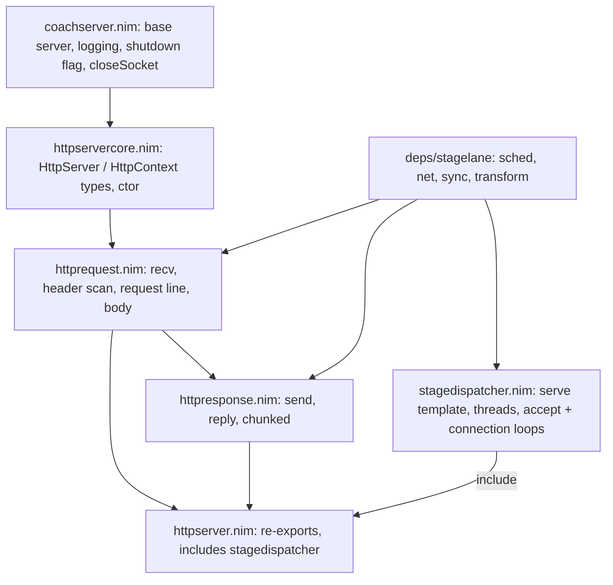

# Stagecoach: Architecture Review and Refactoring Plan

## 1. Architecture summary

Module layering:



Runtime and data flow:
- `serve` (a template) creates N OS threads. Each one runs a stagelane event loop (`run workerAcceptLoop`). On Linux each thread gets its own `SO_REUSEPORT` listener; elsewhere they all share one listener.
- `workerAcceptLoop` uses a per-thread `connSem` to cap connections and spawns one `connectionLoop` flow task per accepted fd inside a `scope`.
- `connectionLoop` handles one request per iteration: `prepareHttpContext` (moves leftover pipelined bytes, the "carry", to the front of the buffer) -> `readHeader` -> acquire `inflight` -> `parseRequestLine` -> body (`Compact` reads into the 100 KB buffer; `Streaming` leaves it to the handler) -> `handler(ctx)` -> `recordCarry` -> a `MSG_PEEK` check for more data.
- Each `HttpContext` owns one `request` buffer of `bufferlength+1` bytes. Every parser function works on offsets into it (`methlen`, `uristart`, `bodystart`, `contentreceived`, `carryStart`).
- Shutdown: SIGINT/SIGTERM -> `shutdown()` sets the global `shuttingdown` and writes a byte to each worker's pipe -> `shutdownAcceptWatcher` cancels that worker's accept task.

## 2. Problem areas (ranked)

### A. Correctness bugs (fix first)

1. **A stale `content-length` carries over between keep-alive requests.** `newHttpContext` always adds `"content-length"` to `ctx.headers`, but `prepareHttpContext` only resets the keys in `server.headerfields`. With `headerfields = ["origin"]` (as in [examples/getandpost.nim](examples/getandpost.nim)), a POST with `Content-Length: 5` followed by a GET makes the server wait for 5 body bytes on the GET until it times out.

```217:219:stagecoach/httprequest.nim
  if server.headerfields.len > 0 and not ctx.headers.isNil:
    for key in server.headerfields:
      ctx.headers[key].setLen(0)
```

2. **The body can include the next pipelined request.** `getBody`, `isBody` and the first `readBodyChunk` slice up to `requestlen`, or by `contentreceived`, which can be larger than `contentlength` when `receiveHeader` has read past the body. For `Streaming`, `recordCarry` also uses `contentreceived`, so those extra bytes are lost as carry (the next request is effectively dropped).
3. **A huge `Content-Length` crashes the process.** `bodystart + contentlength` is unchecked; `Content-Length: 9223372036854775807` raises `OverflowDefect`, which the `except CatchableError` handlers don't catch, so the worker crashes. A negative `Content-Length` is also accepted.
4. **`Transfer-Encoding: chunked` request bodies are ignored.** The body bytes get parsed as the next request. That's a request-smuggling and desync vector; such requests should be rejected.
5. **`keepAlive` is never set to false.** `Connection: close` and HTTP/1.0 are ignored, so the server holds the socket until the idle timeout. Also, HTTP/1.0 is rejected outright because the parser checks `request[uri+8] == '1'`.
6. **The accept loop swallows `CancelledError`.** `except CatchableError: release(connSem)` in `workerAcceptLoop` catches the cancel sent by `shutdownAcceptWatcher`, so the scope "succeeds" and `join`s every connection. Idle keep-alive connections then hold shutdown open for up to `sockettimeoutms`, and forever if it is `<= 0`. A persistent `accept` error (EMFILE) causes a tight CPU spin, because acquire, fail and release repeat with no backoff.
7. **The connection loop keeps going after the handler closes the socket.** `ctx.keepAlive` stays true, so if `carryLen > 0` the loop parses and calls the handler again on `INVALID_SOCKET`.
8. **`hasRequestData` closes healthy connections.** After a spurious wakeup (peek still returns `EAGAIN`), it closes the socket as "client sent nothing".
9. **Buffer overflow if `maxheaderlength > bufferlength`.** `receiveHeader` reads `maxheaderlength - requestlen` bytes into a `bufferlength+1` buffer, and nothing validates the two settings against each other.
10. **The `Content-Length` fast-path scan is too loose.** `findContentLength` searches the whole header block, including the request line, for `content-length:`. So `/content-length:9` in the URI or an `x-content-length:` header both match. Its `i + nlen <= last` bound is also off by one.
11. **Data races:** `shuttingdown` is a plain global read by every thread. `HttpServer` and `HttpRuntime` refs are shared across threads through `{.cast(gcsafe).}`, and ORC reference counts are not atomic. The examples (`asynchandler.inflight`, `support_server.hits`) also mutate globals from several threads.
12. **`recvSome` treats `EINTR` as a fatal error.** `classifySend` treats `ret == 0` as an error and reads a stale `errno`.

### B. Structural problems

- **`serve` is a roughly 120-line template that defines four nested procs** (`stagedispatcher.nim`). Every call site duplicates all of that code. It captures `httpSrv`, `nThreads` and `handler` textually, it's hard to test, and it's pulled in with `include`. Only the `handler(ctx)` call actually needs a template, because flow procs need a static call.
- **Type erasure:** `HttpServerObj.runtime*: pointer`, plus a `cast[HttpRuntime]`, only exists to work around module layout.
- **Functions that classify results also close sockets.** `classifyRecv` and `classifySend` close the socket as a side effect, and callers then close again. Ownership of closing is unclear.
- **Mode branching is spread out.** The `ContentType` mode is checked in `readHeader`, `connectionLoop`, `recordCarry` and `newHttpContext`, and the header-parsing path forks on `headerfields.len == 0`. That gives two different ways of getting `Content-Length`.
- **Unused `server` parameters** in `parseMethod` and `hasRequestData`; `useReusePort` duplicates `listeners.len > 0`.

### C. Duplicated code

- `waitSocketReadable` and `waitSocketWritable` are identical apart from one call.
- The "content-length exceeds buffer" check is repeated three times (`getContentLength`, `readHeader`, `connectionLoop`).
- The `MSG_PEEK` probe appears in both `connectionLoop` and `hasRequestData`.
- `isUri`, `startsUri`, `isMethod` and `isBody` are four copies of the same byte-compare loop.
- `makeListener` duplicates stagelane's `listenTcp` except for one `setsockopt`.
- `closeSocket(ctx)` in `httpresponse` duplicates `closeHttpSocket`.
- The `let j = s.len; setLen(s, j+1); s[j] = x` pattern is used three times instead of `add`.

### D. Performance bottlenecks

- **100 KB zeroed buffer per connection** (`newString(bufferlength+1)`), plus another 100 KB in `Streaming` mode. At 1024 connections per thread that's hundreds of MB. It should start at a header-sized buffer and grow only for a `Compact` body.
- **Extra syscalls per request:** a `MSG_PEEK` after every request, plus another in `hasRequestData`. Calling `recv` directly gives the same information.
- **One timer and one closure per wait** (`addTimer(..., proc () = cancel(self))`) on every readable or writable wait, even on the hot keep-alive path.
- **`parseHeaders` builds strings one character at a time** for every header, including ones nobody asked for, and writes them into a `StringTable`.
- **Several allocations per response:** `reply` builds the response with `&` and `join`. `parseMethod` allocates `request[0..1]` on every request.
- **The in-flight permit is taken before the body is read.** A slow upload holds a handler slot while it trickles in.

### E. Maintainability and security risks

- **No overall request deadline:** `sockettimeoutms` applies to each read, so a slowloris client sending one byte per 4 s can hold a connection for hours (10 KB header limit).
- **Dead code:** [stagecoach/sha.nim](stagecoach/sha.nim) (vendored std SHA-1, left over from websockets), `replyFinish` (always a no-op), the carry branch in `receiveToSingleBuffer` (can't happen, since `recvsize <= need`), the `TryAgain` result from `readBodyChunk`, `SecurityThreatened`, `DontClose`, `storeOsThreadCount`, the deprecated `LogLevel`, and unused imports (`osproc`, `EPIPE`, duplicate `from std/posix`).
- **Mutable `let` strings at module level** in `httpresponse` (hard-coded `http200nocontentlen = 38`) should be `const`.
- **Build:** `config.nims` hard-codes `/Users/alexboisvert/nim/stagelane/src`, which conflicts with the Atlas `nim.cfg` path. `stagecoach.nimble` pins `#head` and declares a library as `bin`.
- **Tests:** they rely on sleeps (`sleep(500)`, `sleep(300)`) and a fixed port. Nothing covers pipelining with bodies, `Connection: close`, oversized or negative `Content-Length`, or shutdown.
- **Docs:** the README says version "9.0.3" while the nimble file says 0.1, and its description of `connLimit` ("per worker (split across workers)") contradicts itself.
- **No error responses:** protocol violations and handler exceptions close the socket with no 400 or 500 response.

## 3. Refactoring strategy (phased)


- **Phase 1, correctness (A1-A12):** add one `bodyEnd` concept and one `validateContentLength`. Reset `content-length` on every request. Reject `Transfer-Encoding`, negative and overflowing lengths. Derive `keepAlive` from the protocol version and the `Connection` header. Re-raise `CancelledError` in the accept loop and back off on accept errors. Make `shuttingdown` atomic. Validate `maxheaderlength <= bufferlength` in `serve`. Write a failing test in [tests/t_parser.nim](tests/t_parser.nim) for each bug before fixing it.
- **Phase 2, deduplication:** add `withSocketTimeout`, `bytesEq`, a single `probeOrRecv`, and a single length check. Remove the socket-closing side effect from `classify*` (return the cause and let the caller close).
- **Phase 3, structure:** move `HttpRuntime` into `httpservercore` (no more `pointer`) and turn `stagedispatcher` from an `include` into a normal module. Split `connectionLoop` into the non-template flow procs `beginRequest(ctx): bool` and `endRequest(ctx): bool`, so the template only wires up `handler`.
- **Phase 4, performance:** grow the buffer lazily, drop the per-request `MSG_PEEK`, use one idle or deadline timer per connection, parse only the requested headers by line (`find('\l')`), build responses into a reused buffer, and take the in-flight permit after the body has been read.
- **Phase 5, cleanup:** delete `sha.nim` and the dead code, make response literals `const`, fix `config.nims`, the nimble file and the README, and replace sleeps in tests with readiness polling.

## 4. Improved code (key replacements)

**Body bounds plus a single length check** (fixes A2, A3, A4, A9 and removes 3 duplicates), in `httprequest.nim`:

```nim
proc bodyEnd*(ctx: HttpContext): int64 {.inline.} =
  if ctx.bodystart < 0: ctx.requestlen
  else: ctx.bodystart + min(ctx.contentreceived, max(ctx.contentlength, 0))

proc validateContentLength(ctx: HttpContext, server: HttpServer, raw: string): bool =
  var n: int64
  try: n = parseBiggestInt(raw.strip())
  except ValueError:
    ctx.closeHttpSocket(ProtocolViolated, "non-parseable content-length"); return false
  if n < 0 or (server.contenttype == Compact and n > server.bufferlength - ctx.bodystart):
    ctx.closeHttpSocket(ProtocolViolated, "invalid content-length"); return false
  ctx.contentlength = n
  true

proc getBody*(ctx: HttpContext): string =
  if ctx.bodystart < 0: "" else: ctx.request[ctx.bodystart ..< ctx.bodyEnd]
```

`recordCarry` becomes `reqEnd = ctx.bodyEnd`. `readBodyChunk` clamps `n` to `contentlength - bodyDelivered`. The `connectionLoop` `Compact` pre-check is deleted.

**Reset per-request header state** (A1):

```nim
if not ctx.headers.isNil:
  for key, _ in ctx.headers.mpairs: ctx.headers[key].setLen(0)
```

**Keep-alive semantics** (A5), set in `parseRequestLine` / `readHeader`:

```nim
let http11 = ctx.request[verEnd] == '1'
let conn = ctx.headers.getOrDefault("connection").toLowerAscii()
ctx.keepAlive = if http11: conn != "close" else: conn == "keep-alive"
if ctx.headers.getOrDefault("transfer-encoding").len > 0:
  ctx.closeHttpSocket(ProtocolViolated, "transfer-encoding not supported"); return false
```

(`"connection"` and `"transfer-encoding"` are always added to `headers`, as `content-length` is today.)

**One timeout helper** (dedupes the two `waitSocket*` procs):

```nim
template withSocketTimeout(ctx: HttpContext, waitCall: untyped) =
  let ms = ctx.server.sockettimeoutms
  if ms <= 0: waitCall
  else:
    let self = curTask()
    let timer = addTimer(ms, proc () = cancel(self))
    try: waitCall
    finally: cancel(timer)

proc waitSocketReadable*(ctx: HttpContext) {.flow.} = ctx.withSocketTimeout(waitReadable(int(ctx.socket)))
proc waitSocketWritable*(ctx: HttpContext) {.flow.} = ctx.withSocketTimeout(waitWritable(int(ctx.socket)))
```

**One byte comparison** (replaces 4 loops):

```nim
proc bytesEq(buf: string, start: int64, s: string): bool {.inline.} =
  start + s.len <= buf.len and equalMem(unsafeAddr buf[start], unsafeAddr s[0], s.len)
proc isUri*(ctx: HttpContext, uri: string): bool = ctx.urilen == uri.len and ctx.request.bytesEq(ctx.uristart, uri)
```

**Accept loop: cancellation and backoff** (A6):

```nim
while not shuttingdown.load(moRelaxed):
  acquire(connSem)
  var stream: TcpStream
  try:
    stream = listener.accept()
  except CancelledError:
    release(connSem); raise          # let scope cancel conns -> fast shutdown
  except CatchableError as e:
    release(connSem)
    s.log(lvlError, "accept: " & e.msg)
    delay(50)                        # EMFILE/ENFILE: don't spin
    continue
  discard conns.go connectionLoop(stream.fd, connSem, inflight)
```

**A smaller `serve` template** (structural): the generic steps become ordinary `{.flow.}` procs in the dispatcher module, and the template keeps only the handler call:

```nim
proc beginRequest*(ctx: HttpContext): bool {.flow.}   # prepare, readHeader, parse, body
proc endRequest*(ctx: HttpContext): bool {.flow.}     # recordCarry, keepAlive/socket checks, wait for next

template connectionLoopFor(handler: untyped) =
  proc connectionLoop(fd: SocketHandle, rt: HttpRuntime, w: Worker) {.flow.} =
    let ctx = rt.server.newHttpContext(fd)
    try:
      while ctx.socket != INVALID_SOCKET and ctx.beginRequest():
        withPermit(w.inflight): handler(ctx)
        if not ctx.endRequest(): break
    except CancelledError: ctx.closeHttpSocket(TimedOut, "cancelled")
    except CatchableError as ex: ctx.closeHttpSocket(Excepted, ex.msg)
    finally:
      release(w.connSem)
      ctx.closeHttpSocket(CloseCalled, "")
```

**Thread-safe shutdown flag** (A11), in `coachserver.nim`:

```nim
import std/atomics
var shuttingdown*: Atomic[bool]
proc isShuttingDown*(): bool {.inline.} = shuttingdown.load(moRelaxed)
```

Files touched: [stagecoach/httprequest.nim](stagecoach/httprequest.nim), [stagecoach/httpresponse.nim](stagecoach/httpresponse.nim), [stagecoach/stagedispatcher.nim](stagecoach/stagedispatcher.nim), [stagecoach/httpservercore.nim](stagecoach/httpservercore.nim), [stagecoach/coachserver.nim](stagecoach/coachserver.nim), [stagecoach/httpserver.nim](stagecoach/httpserver.nim), [tests/t_parser.nim](tests/t_parser.nim), [tests/t_socket.nim](tests/t_socket.nim). Delete [stagecoach/sha.nim](stagecoach/sha.nim).

Verification: targeted `nim c -r tests/t_parser.nim` after each fix. Then `nimble test`, and finally `./query-bench.sh` compared against the current baseline so Phase 4 shows no regression.

## 5. Implementation status (work performed)

All eight to-dos are complete. The parser tests (14) and socket tests (5) pass, all five examples compile, and `query-bench.sh` returned 20,000 x 200 OK at about 110k requests/sec. `nimble test` itself was not run; the two test files were run directly. There is no pre-change benchmark baseline to compare against.

### Done as planned

- **Request framing:**
  - The body no longer includes bytes of the next pipelined request.
  - Huge, negative and non-numeric `Content-Length` values are rejected instead of crashing a worker.
  - `Transfer-Encoding` request bodies are rejected.
  - Request headers are cleared on every request, so a stale `Content-Length` no longer carries over.
  - `Connection: close` and HTTP/1.0 are honoured.
  - Only real header lines are matched, so `/content-length:9` in a URL no longer counts.
- **Accept loop and shutdown:**
  - The accept loop re-raises cancellation, so shutdown no longer waits on idle connections.
  - It backs off 50 ms on accept errors such as running out of file descriptors.
  - `shuttingdown` is now atomic (`isShuttingDown()`).
  - `serve` rejects `maxheaderlength > bufferlength`.
  - The connection loop stops once a handler has closed the socket.
- **Dedupe:**
  - `withSocketTimeout` and `bytesEq` replace the duplicated wait and compare code.
  - Recv classification no longer closes the socket itself; callers close it.
  - Interrupted syscalls (`EINTR`) are retried.
- **Structure:**
  - `HttpRuntime` now lives in `httpservercore.nim`, so the `pointer` cast is gone.
  - `stagedispatcher.nim` is a normal module rather than an `include`.
  - Per-request work moved into `beginRequest` and `endRequest`, and the `serve` template now holds only the glue around the handler.
- **Performance:**
  - The request buffer starts at header size and grows only for a `Compact` body.
  - The per-request `MSG_PEEK` is gone.
  - Headers are parsed line by line, capturing only the ones requested.
  - Responses are built into a reused buffer.
  - The new `requestTimeoutms` (30 s default) caps total header and body receive time against slow-send clients.
  - The in-flight permit is now taken after the body is read.
- **Cleanup:**
  - Deleted `sha.nim` and other dead code, and made the response literals `const`.
  - Socket tests poll for server readiness instead of sleeping, and new tests cover `Connection: close` and an oversized `Content-Length`.
  - README: fixed the `connLimit` and `inflightLimit` wording and the version heading.
  - `stagecoach.nimble`: removed the `bin = @["stagecoach"]` entry.

### Deviations from the plan

- **Extra headers parsed:** `connection` and `transfer-encoding` are always parsed, plus `content-length` when the server reads a body.
- **Per-wait timer:** not replaced with one timer per connection. The new request-level time limit covers the slow-sender case instead.
- **`config.nims`:** it is already gitignored but was tracked, so it was untracked with `git rm --cached`. The file stays on disk with the local stagelane path.
- **Test server counter:** `tests/support_server.nim` now uses an atomic hit counter.
- **Not changed:** the `.cursor/plans` files other than this status section, and 400/500 error responses on protocol violations or handler exceptions.
